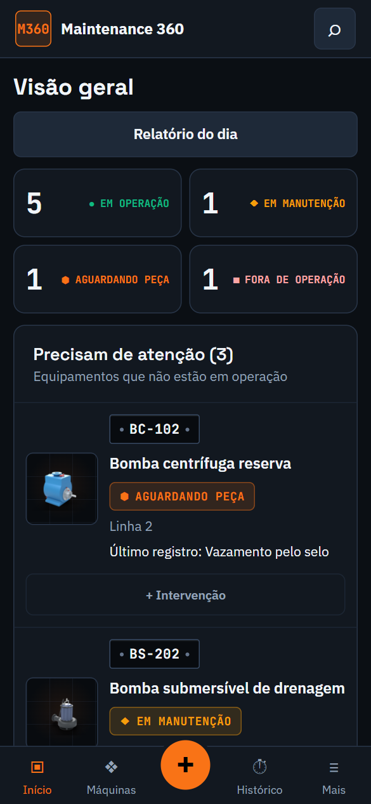
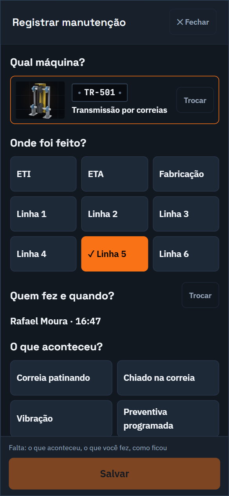
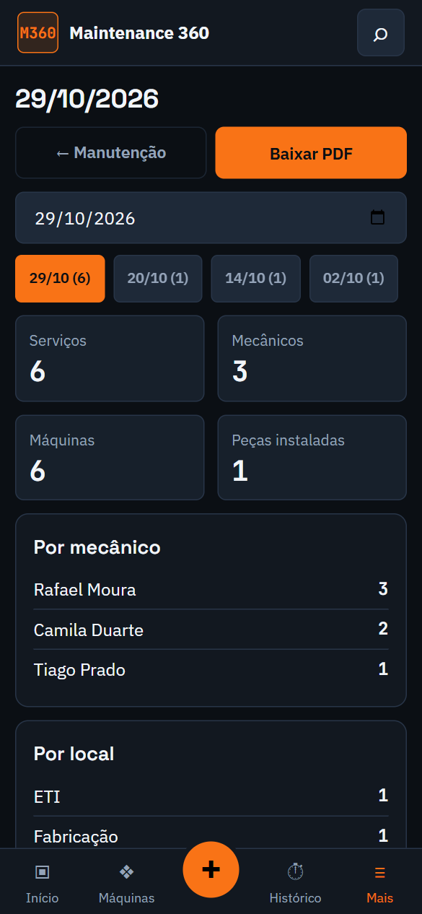
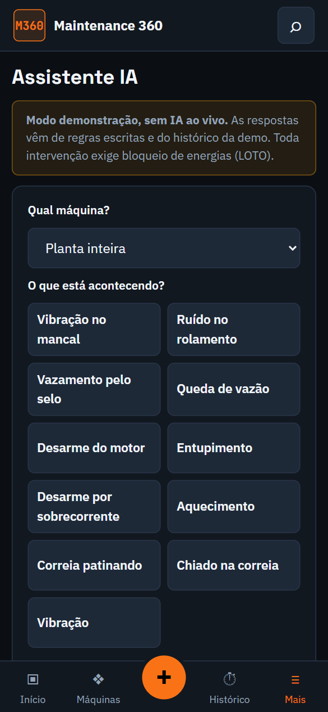

# Maintenance Intelligence 360

**Cada máquina tem uma história. O sistema torna essa história útil para a próxima decisão de manutenção.**

Protótipo de plataforma visual de manutenção industrial, pensado para o mecânico usar no celular, com poucos toques e sem digitar.

**[Abrir a demonstração](https://maintenance-360-demo.netlify.app)**

> Demonstração com dados fictícios: equipamentos, fabricantes, pessoas e documentos foram inventados. Não é um sistema em produção, e os modelos 3D são conceituais.

<p>
  
  
  
  
</p>

## O que ele faz

- **Equipamentos visuais:** catálogo com imagens e bomba em 3D com seleção de componentes.
- **Memória da máquina:** histórico de cada equipamento, com peças trocadas e fotos de antes e depois.
- **Registro por toques:** máquina, local, mecânico, horário, problema, serviço e resultado, com respostas prontas.
- **Relatório do dia:** contagens reais por mecânico, local e resultado, com download em PDF.
- **Assistente com fontes:** separa fatos do histórico, hipóteses e inspeções recomendadas. Não usa IA ao vivo e nunca autoriza troca de peça ou operação; a confirmação é sempre humana.
- **Manuais e busca:** documentos ilustrativos e busca sem acento em todo o conteúdo.

## Como funciona

- Node 24, TypeScript, Hono, SQLite com FTS5 e Zod.
- Interface em JavaScript puro, com Three.js para o 3D.
- Na versão publicada, a mesma API roda no navegador com SQLite em WebAssembly, sem servidor. Os dados ficam só no aparelho de cada visitante.
- Testes com Vitest e testes de interface em desktop, tablet e celular, incluindo verificação de acessibilidade com axe.

## Como rodar

Requer Node 24 ou superior.

```bash
npm install
```

```bash
npm run docs:build
```

```bash
npm run db:seed
```

```bash
npm run start:api
```

O app abre em `http://localhost:8787` e a API fica em `/api`.

## Verificação

```bash
npm run typecheck
```

```bash
npm test
```

```bash
npm run check:content
```

Com o servidor rodando, `npx tsx scripts/e2e-api.ts` testa o fluxo de registro pela API e `npm run e2e:ui` percorre a interface no Chrome instalado, com axe, em desktop, tablet e celular. Os dois gravam dados; rode `npm run db:seed` depois.

## Documentação

- [Arquitetura](docs/ARCHITECTURE.md)
- [API](docs/API.md)
- [Origem e licença dos assets](docs/ASSET_LICENSES.md)

## Sobre

Projeto independente, criado com apoio de ferramentas de IA para código, imagens e renderização. Sem vínculo com nenhuma empresa. Nenhum dado real foi usado.
